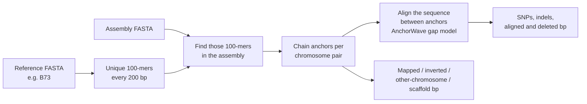
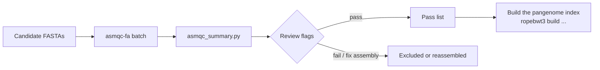

# Screening assemblies with `asmqc` — user guide

This guide explains what `ropebwt3 asmqc-fa` and `ropebwt3 asmqc` do, when to use them, and how to run a
screening of new assemblies from start to finish. For the algorithm, every output column and the
validation numbers, see the technical reference [asmqc.md](asmqc.md).

## What it does

You give it a **reference genome** (for maize, B73) and one or more **assemblies**. For each assembly it
reports, chromosome by chromosome:

- **How much of the reference is found, in order, in the assembly** (*mapped*), and how much is missing
  (*gap*).
- **Structural problems**: reference sequence that sits **inverted**, on **another chromosome**, or on
  **unplaced scaffolds** in the assembly — typical signs of a misjoin, a mislabelled chromosome, an
  incomplete chromosome-level assembly, or a real large inversion.
- **Sequence-level differences**: SNPs, insertions and deletions (counts, bp and sizes), and how much of the
  reference aligns base-for-base (*aligned / identical*) versus is absent (*deleted / replaced*).

These are the same kinds of numbers PHGv2 computes from an AnchorWave alignment
(`phg calc-vcf-metrics`), but in minutes instead of hours, with a few GB of memory instead of a few hundred.

| Per maize assembly, 24 threads | `asmqc-fa` | AnchorWave + gVCF |
|---|---|---|
| Time | ~2–3 min | ~1.5–2 h |
| Peak memory | ~7.5 GB | ~280 GB |

## When to use it

- **Before building a pangenome index.** An index cannot have a line removed later without rebuilding it,
  so check every candidate first, review the flags, and build the index only from the lines that pass.
- **As a quick check of any new assembly** against a reference: did a chromosome get truncated, swapped or
  left in scaffolds?
- **To rank assemblies by divergence** (SNP and indel load) when AnchorWave would be too slow for the
  number of candidates.

It is **not** a replacement for AnchorWave when you need the alignment itself (gVCF / MAF) for
downstream work.

## How it works, in one picture



1. **Anchors.** Short stretches (100 bp) that occur exactly once in the reference and exactly once in the
   assembly are matched up. Genes and other single-copy sequence give dense anchors; repeats give none.
2. **Chains.** Anchors that follow each other in order on the same chromosome are linked into chains. A
   chain on the matching chromosome is *syntenic*; chains in the opposite orientation, on another
   chromosome, or on a scaffold are reported separately.
3. **Between anchors**, reference and assembly sequence are aligned with the same scoring AnchorWave uses
   (2-piece affine gaps), so a long TE insertion costs about the same as AnchorWave would charge.
   Sequence that has no counterpart is counted as deleted (reference side) and inserted (assembly side).

`asmqc` (no `-fa`) does steps 1–2 only, from an existing pangenome index's `.lift` file — useful for a
structural check of lines that are already indexed, in seconds.

## Quick start

Build ropebwt3 (`make`), then:

```sh
# one candidate
ropebwt3 asmqc-fa -t 24 B73.fa candidate.fa > candidate.qc.tsv

# a batch: the reference's anchor table is built once and reused for every assembly
ropebwt3 asmqc-fa -t 24 --chains batch.chains.tsv --variants batch.variants.tsv \
    B73.fa lineA.fa lineB.fa lineC.fa > batch.qc.tsv

# one row per line with flags for review
python3 scripts/asmqc_summary.py --qc batch.qc.tsv --chains batch.chains.tsv \
    --out-tsv batch.summary.tsv --out-json batch.summary.json
```

**Naming.** Each line is named after its FASTA file (`lineA.fa` → `lineA`; a `_renamed` suffix is
dropped). Chromosomes may be called `chr1`, `chr01`, `Chr1` or `lineA_chr1` — they are matched to the
reference by number. Sequences whose name does not start with `chr` are treated as unplaced scaffolds.

**Resources.** Memory is about the size of the reference plus one assembly in RAM (≈ 7–8 GB for maize)
regardless of batch size, because assemblies are processed one after another. `-t` sets threads; the work
is split by assembly chromosome.

## Reading the output

### Per-chromosome table (`batch.qc.tsv`)

One row per line × reference chromosome, plus an `ALL` row. The columns to look at first:

| Column | What it tells you |
|---|---|
| `frac_mapped` | fraction of the reference chromosome found, in order, on the matching assembly chromosome |
| `other_chr_bp` | reference bp found on a *different* assembly chromosome |
| `scaf_bp` | reference bp found on unplaced scaffolds |
| `inv_bp` | reference bp found inverted on the matching chromosome |
| `numSNPs`, `numIndels` | sequence differences |
| `numBasesInserted`, `numBasesDeleted` | bp present only in the assembly / only in the reference |
| `percentRefAligned` | fraction of the reference aligned base-for-base |

Real example — Oh7B from the NAM founders, where part of chr10 is attached to chr9 in the assembly:

```
taxon  chrom      frac_mapped  inv_bp    other_chr_bp  scaf_bp  numSNPs   numIndels  percentRefAligned
Oh7B   B73_chr9   0.977373     2579600   3435200       300300   1047535   162076     0.662433
Oh7B   B73_chr10  0.712129     48900     44187700      346900   856273    126285     0.445546
```

Only 71% of B73 chr10 is found on Oh7B chr10, and 44 Mb of it is on another chromosome. The chain file
shows where:

```
ref_seq    ref_start  ref_end    asm_seq    asm_start  asm_end    strand  n_anchor  class
B73_chr10  14200      43881100   Oh7B_chr9  13808      43892496   +       51963     other_chr
B73_chr9   3695000    163000900  Oh7B_chr9  43896787   205551066  +       276040    syn
```

The first 43.9 Mb of B73 chr10 forms the start of Oh7B chr9, followed by B73 chr9 — a chr9/chr10 swap in
this assembly.

### One row per line with flags (`batch.summary.tsv`)

`asmqc_summary.py` turns the table into a review list. Each line gets a status — **check**, **note** or
**clean** — and plain-language flags:

```
Oh7B    check  CHECK: chr10: only 71.2% of B73 in syntenic chains; CHECK: chr10: 44.2 Mb on other chromosomes;
               NOTE: chr2: 28.4 Mb inverted at breakpoints shared with CML322, Il14H, P39: likely a real inversion polymorphism
Tzi8    check  CHECK: chr7: 38.5 Mb on unplaced scaffolds
CML322  note   NOTE: chr2: 27.3 Mb inverted at breakpoints shared with Il14H, Oh7B, P39: likely a real inversion polymorphism
B97     clean
```

| Flag | Meaning | Default threshold |
|---|---|---|
| low mapped | a chromosome is poorly represented in order | check < 90%, note < 95% |
| on other chromosomes | misjoin, swap or translocation | check ≥ 10 Mb, note ≥ 5 Mb |
| on unplaced scaffolds | chromosome not fully assembled / placed | check ≥ 10 Mb, note ≥ 5 Mb |
| inverted | large inversion (real or assembly error) | check ≥ 10 Mb, note ≥ 5 Mb |
| shared inversion | the same inversion breakpoints appear in another line of the batch | always a note |
| divergent | SNP-level divergence well above the rest of the batch | note |

Thresholds are options of `asmqc_summary.py` (`--check-mapped`, `--note-mapped`, `--check-mb`,
`--note-mb`, `--genome-mapped`). **Screen lines together**: inversions that recur at the same breakpoints in
independently assembled lines are almost certainly real polymorphisms, and the script can only recognise
them within one batch. Some regions are hard for every assembly (in maize, part of chr6 near the rDNA
array maps at ~93–95%); those show as notes on several lines and can usually be ignored.

### The variant stream (`--variants`)

Every difference with its 1-based reference position:

```
#asm_seq    ref_seq    pos(1-based)  type  ref|ref_len  alt|asm_len
Oh43_chr10  B73_chr10  109202761     SNP   T            C
Oh43_chr10  B73_chr10  109205101     INS   0            30
Oh43_chr10  B73_chr10  110913653     REP   3582         2329         2
```

`REP` (replacement) is a stretch with no alignable counterpart: the reference bp are counted as deleted and
the assembly bp as inserted (the last column is an internal reason code). The file can be large for a whole
batch (~0.5 GB per maize line).

## Reviewing a batch



1. Run the batch and the summary.
2. Look at **check** lines first. For each flag, the chain file (and the flag's coordinates in
   `summary.json`) says which reference interval went where in the assembly — enough to judge a misjoin
   against known biology or the assembly's own evidence.
3. Look at **note** lines; shared inversions and known hard regions usually pass.
4. Build the index from the lines that pass.

The `summary.json` written by `asmqc_summary.py` contains everything needed for a shared review page (one
row per line, flags with coordinates, per-chromosome numbers); a page with Pass/Fail buttons was built from
it for the 24 NAM founders.

## Comparing with AnchorWave

If AnchorWave/PHG metrics exist for some lines, put them side by side:

```sh
phg calc-vcf-metrics --vcf-dir gvcfs/ -o aw_metrics.tsv
python3 scripts/asmqc_summary.py --qc batch.qc.tsv --chains batch.chains.tsv --anchorwave aw_metrics.tsv ...
python3 scripts/asmqc_vs_anchorwave.py --qc batch.qc.tsv --anchorwave aw_metrics.tsv
```

What to expect (24 NAM founders, details in [asmqc.md](asmqc.md)): mapped, identical, inserted and
deleted bp agree with AnchorWave within a few percent and correlate at r ≥ 0.98; insertion/deletion event
counts are ~0.84×; **SNP counts are lower, at a near-constant ratio** across lines, so lines rank the same.
Only compare against AnchorWave runs on the *same* assembly files — metrics from older runs can differ by
>15% in SNP count by themselves.

## FAQ

**Why does asmqc report fewer SNPs than AnchorWave?** Almost all of the difference is in TE-rich sequence
that is present in the reference but absent at that position in the assembly. AnchorWave aligns such
sequence to whatever is nearby — often a different copy of a related TE, sometimes unrelated sequence — and
reports the differences as SNPs. asmqc reports it as deleted (and the other sequence as inserted). Checked
on Oh43 chr10: for 87% of the AnchorWave SNPs asmqc does not call, the sequence's close (≥ 90%) copy is
elsewhere in the Oh43 genome; only ~2% are genuinely missed. asmqc's count is a "same-position SNPs"
count.

**Is mapped = 99% good?** For maize inbreds against B73, most chromosomes sit at 98–100%. Below 95% is worth
a look; below 90% usually means something structural (see the flags).

**Do I need an index?** No for `asmqc-fa`. `asmqc` needs an existing index's `.lift` and `.len.gz` and gives
structure only (no SNPs).

**Which reference should I use?** The one the pangenome index will use as its coordinate system. The
reference's file name becomes its taxon name; pass `--ref-name` to override.

**How do I re-run one line?** Run `asmqc-fa` with just that FASTA; results are independent per line (only
the shared-inversion note in the summary depends on the batch).

**Can I make it closer to AnchorWave?** Several approaches were tested (unbanded alignment, repeat-aware
chaining, rescue of replaced segments, soft anchors); none helped meaningfully. They remain available as
off-by-default switches — see [asmqc.md](asmqc.md#experimental-options-off-by-default).
