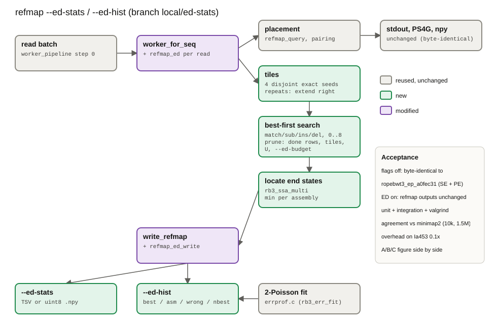

# refmap per-read edit distance to each assembly (`--ed-stats`, `--ed-hist`)

*Generated by `plan_diagram.py` (hand-authored SVG); regenerate with
`python3 docs/ed-stats/plan_diagram.py && rsvg-convert -o docs/ed-stats/plan_diagram.png docs/ed-stats/plan_diagram.svg`
whenever the stage list changes. Gray = reused unchanged, green = new, purple = modified.*

Branch `local/ed-stats`, cut from `local/err-profile-filter` (b8ae9a0; code a0fec31). Goal: the
"best hit" edit-distance distributions made so far with minimap2 (one alignment run per panel
assembly, `scratch/editdist/`) come straight out of one refmap run against the pangenome index.
Everything is opt-in; with the flags off, output is byte-identical to `ropebwt3_ep_a0fec31`.

## Definition

For a read and an assembly: the minimum number of edits -- substitutions, inserted or deleted
bases (a k-bp indel costs k), and read bases left unaligned at a contig end -- that turn the
whole read into a substring of that assembly, either strand. Unaligned bases cost the same as
insertions, so this is the semi-global edit distance (read end to end, free ends on the
assembly). The panel best is the minimum over assemblies; the closest distinct wrong copy is the
minimum over assemblies more than 1 edit worse than the best (panel B of the minimap2 figure).

How it differs from the minimap2 numbers (NM + soft-clipped bases of the best alignment):

- minimap2 maximises an affine score, not edits. Near a read end it soft-clips instead of taking
  a mismatch (a mismatch 3 bp from the end costs 8, clipping 3 bp costs 6), so its "edit
  distance" there is 2-3 where the minimum is 1. ropebwt3's value is never above the true minimum
  for the copies it finds; minimap2's can be.
- Seeds: a copy is found only if one of the read's tiles occurs in it exactly (below).
  minimap2 needs a minimizer chain instead. Both miss copies that diverge everywhere.
- Cap: values above `--ed-max` (8) are NA; minimap2 reports any value.
- Indels are not limited to 1 bp (unlike the err-profile events), but each indel base costs 1,
  as NM counts it.

## Search

1. **Tiles.** The read is cut at `--ed-tiles` (4) nominal boundaries into disjoint tiles. A tile
   occurring more than `--ed-max-occ` (1000) times is extended to the right until it does not, so
   repeats get fewer, longer tiles; if it still does at the read end it is skipped (flag R). If
   the whole read occurs more than `--ed-max-occ` times, its first `--ed-max-loc` copies are
   located at cost 0 and nothing is searched (flags R, L).
2. **Best-first extension** per tile, in the bidirectional FM-index: Dijkstra over integer costs
   (a bucket queue), first to the left (to the right for the first tile), then the other side. A
   state is (FMD interval, read position, cost); moves are match (0), substitution, read
   insertion and read deletion (1 each). The interval holds every indexed copy whose text the
   path has spelled, so copies that agree share one state; the search branches only where copies
   differ or an edit is made.
3. **Attribution.** A popped state that has aligned the whole read is the cheapest alignment of
   the copies it holds. They are located (`rb3_ssa_multi`, at most `--ed-max-loc` = 64; flag L if
   more) and each copy's assembly (sample prefix of its contig name) gets that cost if lower.
4. **Pruning.**
   - Finished copies: in the first phase the intervals are sub-ranges of the tile's interval on
     that side; in the second, sub-ranges of the first-phase end interval on the other side. So
     "every copy of this state already has its cost on this side" is a range check (union-find
     over the frame's rows).
   - Complete tiles: a path that crosses an earlier complete tile without an edit inside it is an
     alignment that tile's own search covered. Tiles go left to right and later tiles search left
     first, so most of their paths stop before the second phase.
   - U: a tile stops at the cost no assembly could improve on (the largest current value).
   - `--ed-budget` (2000) expanded states per tile; past it the tile is truncated (flag T).
5. **Exactness.** A copy within e edits leaves one of e+1 disjoint tiles untouched, so with t
   complete tiles every value <= t is exact, a larger value is an upper bound, and NA means
   nothing <= cap was found (the `tiles` column). The tile loop stops early once every value is
   <= t. An end state cheaper than t is not located (an earlier tile found its copies).
6. **Panel best** (`best` column) is the cheapest whole-read alignment seen, kept even when its
   copies were not all located, so the global distribution does not depend on attribution.

## Flags (refmap only)

| Flag | Meaning |
|---|---|
| `--ed-stats=FILE` | per read: best, n_best, closest wrong copy, flags, complete tiles, one value per assembly (NA = none <= cap). With `--paired`: mate rows `1`/`2` and a pair row `P` (per-assembly sum of the mates). `FILE.npy`: uint8 matrix, reads x (assemblies, best, flags byte), 255 = NA, input order, sidecar `FILE.npy.cols.tsv` |
| `--ed-hist=FILE` | TSV: `unit measure k count frac cum_frac err_expected post_err`; measures best / asm / wrong / nbest, for reads and (with `--paired`) pairs; the best rows carry the two-Poisson sequencing-error fit of `errprof.c` |
| `--ed-max=INT` | cap [8], at most 60 |
| `--ed-tiles=INT` | tiles per read [4] |
| `--ed-max-occ=NUM` | repetitive-tile cutoff [1000] |
| `--ed-budget=NUM` | expanded states per tile [2000] |
| `--ed-max-loc=INT` | copies located per aligned interval [64] |
| `--ed-frac=FLOAT` | fixed hash subsample of reads (pairs) [1]; others get flag S / NA (npy) and no TSV row |

npy flags byte: bit 0 T, 1 R, 2 N (no usable tile), 3 L, 4 S (not sampled), bits 5-7 = complete
tiles (max 7).

Not supported: `--walk-mode=per-assembly`. Works with `--kmer`, `--paired`, the err/span filters
and every placement output, which it does not change.

## Code

- `edstats.c/h`: pure part (summary of a per-assembly vector, pair sums, histogram accumulator
  and writer, npy header).
- `search.c`: `refmap_ed` (tiles), `ed_tile` (search), `refmap_ed_write` / `refmap_ed_row` /
  `refmap_ed_finish` (outputs), options and setup. `RB3_ED_PROF=1` in the environment prints
  work totals (tiles, expanded states, located copies) at the end.

## Tests

- `test/test_edstats.c` (23): summary (best, n_best, wrong, a best without its assembly), pair
  sums, histogram counts and writer, npy header.
- `test/run_integration.sh` section 15 (21 checks + valgrind): the err fixture reads at their
  known edit counts in all four genomes (subs, 1-bp insertion and deletion, end subs); `--ed-max`;
  `.npy` shape and bytes; `--paired` mate and pair rows (insertion-only sequence, three Ki3 SNPs,
  junk); `--ed-hist`; `--ed-frac`; refmap stdout unchanged with the flags on; error paths.

## Results

Binary `grits_workdir/scratch/edstats/bin/ropebwt3_ed_ced1849`; driver `run_all.sh`, comparison
and figure `scripts/compare_plot.py`, 10k comparison `scripts/cmp10k.py`, all in
`grits_workdir/scratch/edstats/`. Production refmap flags (k50 lift, `--lift-chain-nb=3
--lift-chain-interp`, `-l 19`), `-t 8`, default `--ed-*` values.

**Byte identity.** Flags off vs `ropebwt3_ep_a0fec31`: single-end refmap/chain/chain-best/mem/sw
on 100k reads (`se_identity.sh`) 20/20 files; `--paired` on Ia453 and B73xOh43 0.1x (tsv, ps4g,
npy + 3 sidecars) 12/12. With `--ed-stats --ed-hist` on, the same 12 PE files and the SE stdout of
all 1.52M Ia453 reads are identical to the flags-off run (13/13).

**Overhead** (wall, 8 threads, shared machine):

| run | off | `--ed-stats --ed-hist` | `--ed-frac=0.1` |
|---|---|---|---|
| Ia453 0.1x SE, 1.52M reads | 144 s | 757 s (5.3x) | 191 s (1.33x) |
| Ia453 0.1x `--paired` + ps4g/npy | 123 s | 615 s (5.0x) | |
| B73xOh43 0.1x `--paired` + ps4g/npy | 144 s | 648 s (4.5x) | |

The full run is over the 2-3x target. Two costs, about equal: ~2,700 expanded states per read
(maize TE fragments: a 37 bp tile often has hundreds of copies) and ~60 located copies per read
at ~35 us each (one SA sample per 256 rows in this index). Locating is the floor: per-assembly
values need every copy's assembly, and copies within 8 edits are many. `--ed-frac=0.1` gives the
histograms at 1.33x: read best <=0/1/2/3 = 80.61/94.59/96.82/97.54% vs 80.62/94.66/96.87/97.60%
on all reads. On the 10k sample, `--ed-tiles=2` halves the search cost (CPU ~2x of refmap with the
index load) at 67% instead of 80% cell agreement.

**Agreement with minimap2, all 1,520,864 Ia453 0.1x reads (R1+R2)**, minimap2 capped at 8 the same
way (`compare_all.txt`):

- Panel best (A blue, C): 97.4% of reads identical. Best <=0/1/2/3: minimap2 80.02/94.90/97.36/98.19%,
  ropebwt3 80.62/94.66/96.87/97.60%. Sequencing-error fit: mu0 = 0.20 errors/read (0.21 from
  err-profile); post_err(best=3) = 0.62, (4) = 0.04.
- Per read x assembly (A orange): 79.4% identical (68.7% same value, 10.7% both >8/none).
  By minimap2 value: 0 -> 98.1% equal, 1 -> 85.9%, 2 -> 76.4%, 3 -> 61.1%, 4 -> 39.0%, 5-8 -> 13-28%.
  ropebwt3 lower in 4.6% of cells (minimap2 clips read ends: an end mismatch becomes 2-3 clipped
  bases), higher in 2.2%, NA where minimap2 has <= 8 in 13.2% (the misses grow with distance:
  copies of 4+ edits that touch every tile, budget-truncated reads, repeats).
- By flag: clean reads (31%) 93.5% cell agreement; T 74.5%, TR 63.3%, R 50.8%, L 85.5%.
- Closest distinct wrong copy (B): 77.6% identical; <=2/3/4 minimap2 31.7/46.8/54.5%, ropebwt3
  29.4/42.4/47.8%; ropebwt3 finds one for 54.8% of reads vs 66.0%.
- 10k sample (`reads10k.fq`): 79.6% of cells, 97.8% of panel bests identical.

Figure: `scratch/edstats/editdist3_ed_vs_mm2.png` (A/B/C, minimap2 left, ropebwt3 right, both
capped at 8). Panel C's true-source series stays minimap2 against Ia453, which is not in the index.

**Reading it.** The panel-best distribution (what panel C and the per-read error cutoff use) comes
out of ropebwt3 within 0.6 pp of minimap2. Per-assembly values are exact where they are small
(<= 2 edits: 86-98% agreement) and increasingly censored above 3, so ropebwt3's per-assembly and
closest-wrong-copy tails sit lower and its ">8/none" bar higher (23.8% vs 11.4% of cells).
