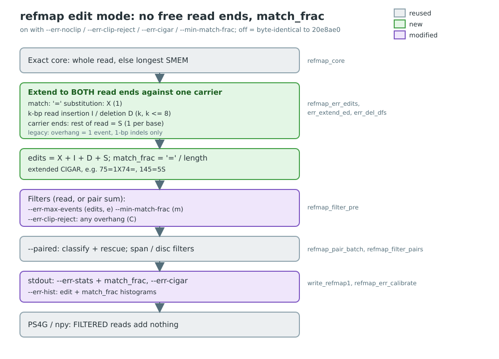

# refmap edit mode: no free read ends, match_frac, extended CIGAR

*Hand-authored `plan_diagram.svg` (grey = reused, green = new, purple = modified); regenerate with
`rsvg-convert -o docs/edit-match-frac/plan_diagram.png docs/edit-match-frac/plan_diagram.svg`.*

Branch `local/edit-match-frac`, cut from `local/readfilt-errprofile` (20e8ae0). Local only.
Builds on the error-profile filter (`docs/err-profile/PLAN.md`).

## The leak

The legacy event count (`refmap_err_events`) extends the read from its exact core against one
carrier. When every carrier in the interval ends (contig end, assembly gap), the whole rest of
the read counted as **one** event, so a read hanging 20 bp off a contig paid 1. It also only
knew 1-bp indels, so a 3-bp insertion cost 8 events and a 3-bp deletion hit the cap (20).

Other paths checked:
- Longest-SMEM core: not a leak. The extension always continues past mismatch clusters from
  the core's full interval, so every read base outside the core is either matched or charged.
  The only exit was "no base extends at all" (the overhang above).
- `--trim-polya` (off by default) deletes terminal poly-A/T before anything is counted, so
  those bases would be free. Edit mode refuses it.
- Coreless reads (no SMEM >= -l): no carrier; they are UNPLACED, count as the cap (20) in a
  pair, and add 0 '=' bases and their full length to a pair's match_frac.
- `--kmer` and per-assembly walk mode are still rejected for every `--err-*` flag.

## Edit mode

On with any of `--err-noclip`, `--err-clip-reject`, `--err-cigar`, `--min-match-frac`.
With all four off the legacy count runs and output is byte-identical to 20e8ae0.

Same core, same extension (right to the read end, then left), against the one carrier the
FMD interval ends on. Every read base gets exactly one op, and there is no clipping:

| op | meaning | edits |
|---|---|---|
| `=` | read base matches the carrier | 0 |
| `X` | substitution (also an N in the read) | 1 |
| `I` | read base absent from the carrier; k-bp insertion | k |
| `D` | carrier base absent from the read; k-bp deletion | k |
| `S` | read base past the carrier's end (contig-end overhang) | 1 per base |

- **edits** = X + I + D + S bases. This is what `--err-max-events` caps in edit mode (per read,
  or the pair sum with `--paired`; capped at 20 like before). `--err-max-events=1` therefore
  removes every read with more than one substituted, inserted, deleted or overhanging base.
- **match_frac** = `=` bases / read length. D bases are in neither numerator nor denominator;
  X, I and S bases are in the denominator only. Per pair = sum of `=` / sum of read lengths.
- Edit choice at a non-extending base: substitution, a 1..8 bp read insertion, or a 1..8 bp read
  deletion (every carrier path of that length, max 256 interval extensions per event). Score =
  read bases matched in the next 12 - (cost - 1); ties go to the substitution, then the
  shorter indel. Only when no base extends at all is the rest of the read `S`.
- Greedy, so an upper bound on the true minimum against the panel (see minimap2 below).

Flags:
- `--err-noclip`: count edits instead of legacy events.
- `--err-clip-reject`: FILTER (reason `C`) any read with an overhang; with `--paired`, both mates.
- `--min-match-frac=FLOAT`: FILTER (reason `m`) below FLOAT; with `--paired`, per pair.
- `--err-cigar`: append the extended CIGAR (e.g. `75=1X74=`, `145=5S`) as a column.
- `--err-stats` gains a `match_frac` column (4 decimals, `.` = no core) after the reason.
- `--err-hist` events become edits, and two blocks follow: `read_mf` / `pair_mf`, bin =
  floor(100 * match_frac), with `cum_ge` = fraction at or above the bin.
- Filter order per read/pair: edits (`e`), match_frac (`m`), overhang (`C`), span (`S`).

## Checks

- **Byte-identity, all new flags off**, vs `ropebwt3_readfilt_errprofile_20e8ae0` (raw.tsv, npy,
  bins, gametes, layout, ps4g minus #Command): single-end IDX-HYB B73xCML103 and OUT-INBRED Ia453
  0.1x, legacy `--err-max-events=1 --err-stats` on Ia453, `--paired` Ia453 and IDX-HYB B73xOh43
  0.1x. 5/5 identical.
- **Fixture** (`test/make_edit_fixture.py`, `docs/examples/edit/expected.tsv`): 0/1/2
  substitutions, 1- and 3-bp insertions and deletions, a substitution in the first and in the
  last base, contig-end overhangs of 1/5/20 bp at the right and left ends. All 15 edits, match_frac
  and CIGARs exact (legacy on the same reads: I3 = 8, D3 = 20, every overhang = 1). Plus filter,
  pair and histogram checks and valgrind. `make test`: 17 unit + 254 integration pass.
- **minimap2** (10k simulated Ia453 reads, `-ax sr -N 5` against each of the 25 assemblies; best
  over all alignments; mm2 edits = NM + soft clips, '=' = M - (NM - I - D), identical to `--eqx`
  on B73/Oh43/Tzi8 for every primary alignment): edits identical for 96.9% of reads, within 1 for
  98.1%; '=' bases identical 96.8%, within 1 base 98.1%. Reads at <= 1 edit: refmap 94.6%,
  minimap2 95.3%. refmap is lower for 0.7% (an exact copy minimap2 missed) and higher for 2.4%
  (greedy carrier choice).

## Full row: OUT-INBRED Ia453 0.1x (1.52M reads / 760k pairs), no filter

| | edits <= 1 | edits <= 2 | mf >= 0.99 | mf >= 0.98 | mf >= 0.95 |
|---|---|---|---|---|---|
| reads (of 1,520,860 with a core) | 94.22% | 96.43% | 94.70% | 97.69% | 99.04% |
| pairs (of 760,432) | 88.55% | 93.27% | 95.42% | 97.46% | 99.07% |

Edits per read 0/1/2/3/4/5+: 80.6 / 13.6 / 2.2 / 0.9 / 0.6 / 2.1%. Per pair 0/1/2/3+:
67.1 / 21.5 / 4.7 / 6.7%. match_frac bin 100/99/98/97-95/<95: reads 81.1 / 13.6 / 3.0 / 1.4 /
1.0%; pairs 67.7 / 27.8 / 2.0 / 1.6 / 0.9%. Full tables:
`grits_workdir/scratch/editmatch/fullrow_Ia453_0.1x.txt`, and `runs/{se,pe}_ia_edit/err.hist`.

Edit mode changes the per-read count for only 0.8% of reads on this row (mostly multi-bp indels
now cheaper). Only 22 reads have a contig-end overhang at all, and 3 of them move from <= 1
legacy event to > 1 edit: the overhang leak is real but tiny on simulated reads (assembly gaps
in real data may matter more).

Per pair, 0.99 is looser than edits <= 1 (a 300 bp pair at 0.99 allows 3 non-'=' bases).

Cost (not a clean benchmark: 12 jobs shared the machine): user CPU on the SE row was 1036 s with
the flags off, 1087 s with the legacy count, 1205 s in edit mode with `--err-hist` over every read
(which runs the edit count twice: pre-pass + main pass).
