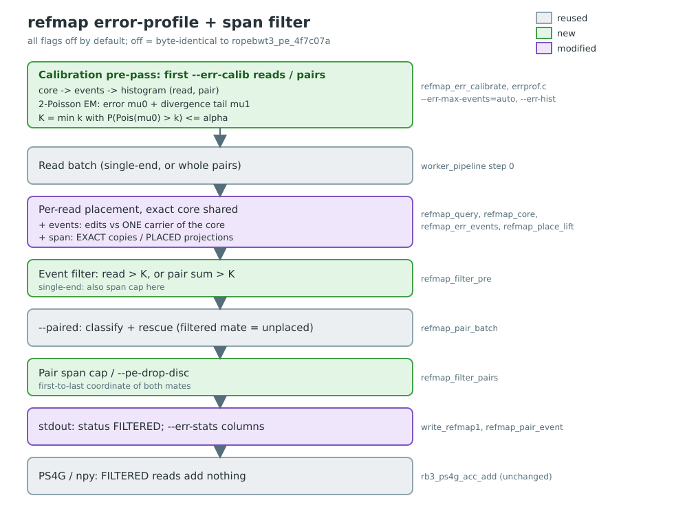

# refmap error-profile filter and reference-span cap

> **This is a developer design note.** It records how the error-profile filter works internally, how it was tested and
> what was measured, and it uses the code's own terms. To *use* the feature, read the plain-language
> [GRITS overview](../grits-overview.md) and the README instead.

**In short:** two optional filters that remove reads likely to be placed in the wrong spot.
1. The **error filter** counts how many differences a read has against the genome it matched. Sequencing
   errors rarely add more than one or two, so reads with more are probably from somewhere else.
2. The **span cap** removes reads (or pairs) whose possible positions on B73 are spread over too wide a
   distance.

*Hand-authored `plan_diagram.svg`; regenerate the PNG with
`rsvg-convert -o docs/err-profile/plan_diagram.png docs/err-profile/plan_diagram.svg`.*

Branch `local/err-profile-filter`, cut from `local/paired-end` (c9bd9d2, draft PR #8).
Goal: drop reads/pairs that carry more mismatch events than sequencing error explains, and
reads/pairs whose reported reference coordinates span too far, before they reach PS4G/npy.
Everything is opt-in; with the flags off, output is byte-identical to `ropebwt3_pe_4f7c07a`.

## Events

refmap places a read with an exact core: the whole read, or its longest SMEM. An **event** is
one edit needed to explain the **whole** read against **one** indexed sequence that carries the
core (`refmap_err_events`):

- Start from the core's bidirectional FMD interval; extend right to the read end, then left.
- While the next read base extends the interval, the read still matches some carrier end to end.
- When it does not, count one event and take the edit whose continuation matches the most
  following read bases (12 bp lookahead): substitution (preferred on ties), read insertion
  (skip the base), or read deletion (carrier has an extra base). A carrier that ends (contig
  end) counts the overhang as one event. Counting stops at 20.
- The interval stays non-empty, so the edits are against one sequence, not a mosaic of SMEMs
  from different assemblies. Greedy, so an upper bound on the minimum edit count.
- Cost: about 150 extension steps per non-exact read, no locate. A 20k-pair run went from
  index load to done in 7 s.

For a pair, the event count is the two mates' counts added together. A mate that has no exact
match long enough to start from cannot be counted, so it is given the maximum count (20). So in
practice a pair with one unplaceable mate is always over the limit.

Validation on wgsim Oh43 pairs (in panel, so every event is a sequencing error): all 14,769
error-free pairs have 0 events; 4,165 of 4,492 one-error pairs have exactly 1. (wgsim's
per-mate error fields are not reliable per mate, only per pair.)

## Calibration (`--err-max-events=auto`, `--err-hist`)

**What it is for.** The right limit depends on the sequencing error rate of the run, which differs
between runs. With `--err-max-events=auto`, refmap picks the limit from the data instead of you
choosing a number.

**How.** Before the real run, refmap reads the first `--err-calib` reads (default 1,000,000; pairs
with `--paired`) and counts their events, giving a histogram: how many reads have 0, 1, 2, ...
events. Most reads have few events, from sequencing errors. A smaller group have many, because they
come from sequence that differs from every genome in the index. refmap fits these two groups as two
Poisson distributions. The limit is then the smallest event count that sequencing errors alone exceed
less than once in 1,000 reads (`--err-alpha`, default 0.001). The histogram is of pairs with
`--paired`, reads otherwise.

*Technical detail:* the fit is a two-component Poisson mixture estimated by EM. Component 0 is the
sequencing-error floor (mean mu0), and component 1 is the divergence tail, with the last histogram
bin treated as censored. The cutoff is the smallest K with P(Poisson(mu0) > K) <= alpha.
`--err-hist=FILE` writes both histograms with the fit, the expected error-only count and the
posterior probability that each count is sequencing error.

## Span

**What it is.** A read can point to more than one position on B73: several B73 copies, or several
founder copies that translate to different B73 places. The **span** is the distance between the
first and last of those positions. A read whose candidate positions are close together has a small
span, and one whose candidates are far apart has a large span. `--max-ref-span=N` removes reads with
a span over N bp.

**Candidates on different chromosomes** have no meaningful distance. They are given a span of
"infinite", meaning larger than any limit, so any `--max-ref-span` removes them. `--err-stats`
writes it as `inf`.

How the span is measured for each kind of read:

- Single-end EXACT: from the first to the last B73 copy of the read.
- Single-end PLACED: the spread of every assembly's lift projection. So `--max-ref-span=N` on a PLACED read equals preset F's
  `--placed-min-chr-agree=1 --placed-max-spread=N` (refmap-read-filters 1d7a3cc), which only
  measures the majority sequence's spread.
- `--paired`: from the first to the last position of both mates together, after rescue (pair
  classes `CONC`, `RESC`, or `DISC` on one chromosome). A `DISC` pair whose mates are on different
  chromosomes is infinite. For a `SOLO` pair it is the placed mate's own span. CONC pairs are
  at most max insert + `--pe-slack` by construction, so a cap at or above that bites on DISC
  and SOLO pairs. `--pe-drop-disc` drops DISC pairs outright.

## Flags (refmap only)

| Flag | Meaning |
|---|---|
| `--err-max-events=INT\|auto` | max events per read, or per pair (sum) with `--paired` |
| `--err-calib=NUM` | calibration pre-pass size, reads or pairs [1000000] |
| `--err-alpha=FLOAT` | auto: tail probability of the error component [0.001] |
| `--err-hist=FILE` | calibration histograms + fit (TSV) |
| `--err-stats` | append `events`, `span` (`inf` across sequences), filter reason (`e`/`S`/`D`/`.`) |
| `--max-ref-span=NUM` | span cap in bp (0 = off) |
| `--pe-drop-disc` | `--paired`: FILTER discordant pairs |

A rejected read, or both mates of a rejected pair, gets status `FILTERED` (the same status and
code, 5, as refmap-read-filters, so the two compose) and adds nothing to `--ps4g`, `--npy`,
`--ps4g-per-read` or `--target-hits`. A pair the event filter rejects becomes `NONE` for pairing.

**Not supported:** `--kmer`, `--walk-mode=per-assembly`, and stdin input for `auto`/`--err-hist`
(the input is read twice). chain/mem/sw: see the end.

## Code

- `errprof.c/h`: pure statistics (Poisson pmf/tail, EM fit, cutoff, sidecar writer).
- `search.c`: `refmap_core` (the shared exact-core choice), `refmap_err_events`,
  span in `refmap_query`/`refmap_place_lift`, `refmap_filter_pre`, `refmap_filter_pairs`,
  `refmap_err_calibrate`, `--err-stats` columns.

## Tests

- `test/test_errprof.c` (17): Poisson basics, cutoffs, EM recovery on pure, mixed and
  censored-tail histograms, sidecar writer.
- `test/run_integration.sh` section 16 (21 checks + valgrind) on `docs/examples/err/`
  (`test/make_err_fixture.py`): exact event counts for 0-3 substitutions, a 1-bp insertion,
  a 1-bp deletion and end errors; per-read and per-pair cutoffs; auto + `--err-hist`; the
  junk-mate cap; `--max-ref-span` single-end and paired; `--pe-drop-disc`; filters-off
  identity; error paths.

## Results (2026-10-19, binary `ropebwt3_ep_a0fec31`)

Data: `grits_workdir/scratch/err_profile/` (driver `run_all.sh`, scorer `ep_eval.py`).
Production refmap flags (k50 lift, `--lift-chain-nb=3 --lift-chain-interp`, `-l 19`).
Samples: wgsim Oh43 (in panel, 500k pairs, `-e 0.001`), and the simval 0.1x rows
OUT-INBRED Ia453, IDX-HYB B73xOh43 and OUT-HYB A188xEP1 (R1/R2, 0.72-0.76M pairs).
"Wrong" = PS4G event on another chromosome or >= 20 kb from the fragment's truth position
(collinear fragments, truth gVCF maps; no per-read parent truth for B73xOh43). Cutoffs are
replayed offline from unfiltered `--err-stats` runs; two real filtered runs reproduce the replay
exactly (Ia453 K=2 + span 2744: 379,589 events, 9,077 wrong in both).

**Byte identity, flags off:** single-end refmap/chain/chain-best/mem/sw on 100k real reads
(`se_identity.sh`, 20/20 files) and refmap `--paired` on the three full corpus rows
(tsv, ps4g, npy and 3 sidecars: 18/18) are identical to `ropebwt3_pe_4f7c07a`.

**Event histogram per pair (fraction; cumulative) and wrong events by count:**

| events / pair | Oh43 sim | Ia453 | B73xOh43 | A188xEP1 | wrong %: Oh43 / Ia453 / A188xEP1 |
|---|---|---|---|---|---|
| 0 | 74.5 | 67.1 | 74.5 | 54.6 | 4.9 / 5.7 / 5.9 |
| 1 | 20.6 (95.1) | 21.5 (88.6) | 20.6 (95.1) | 20.5 (75.1) | 6.0 / 7.4 / 8.1 |
| 2 | 3.3 (98.3) | 4.7 (93.2) | 3.2 (98.3) | 5.6 (80.7) | 13.2 / 16.4 / 16.7 |
| 3 | 0.6 (99.0) | 1.5 (94.7) | 0.6 (99.0) | 2.3 (83.0) | 38.6 / 35.2 / 33.2 |
| 4 | 0.3 | 0.9 | 0.3 | 1.6 | 56.5 / 47.9 / 43.4 |
| >= 8 | 0.6 | 4.2 | 0.6 | 15.3 | 59 / 49 / 57 |
| fitted error mu0 / auto K (alpha 1e-3) | 0.30 / 3 | 0.40 / 3 | 0.29 / 3 | 0.58 / 4 | |

Per read (single-end), the same shape one step earlier: 0/1 events 4-9% wrong, 2 events
22-24%, 3 events 49-80%, 4+ 59-99%. wgsim's true pair error rate is 0.30, so the fit is exact
in panel and drifts up with divergence (Ia453 0.40, A188xEP1 0.58): one-SNP divergent reads
look like sequencing error. The drift only raises the cutoff (keeps more).

**Paired cutoff table.** Each cell lists several numbers separated by `/`:

- **kept**: % of PS4G events (read pairs) that pass the filter.
- **wrong k**: % of the *kept* events that are misplaced (on the wrong chromosome or ≥ 20 kb from
  the true position). Lower is better.
- **wrong r** (or just **r**): % of the *removed* events that were misplaced. Higher means the filter
  removes mostly bad events.
- **founder**: % of kept events whose founder set contains the true founder (for B73xOh43, either
  parent). Higher is better.

| cutoff | Oh43: kept / wrong k / wrong r / founder | Ia453: kept / wrong k / wrong r | A188xEP1: kept / wrong k / wrong r | B73xOh43: kept / founder |
|---|---|---|---|---|
| none | 100 / 6.43 / - / 97.77 | 100 / 8.76 / - | 100 / 14.38 / - | 100 / 98.15 |
| ev <= 1 | 94.1 / 5.12 / 28.5 / 99.08 | 86.0 / 6.10 / 33.0 | 71.1 / 6.49 / 42.6 | 94.1 / 99.28 |
| ev <= 2 | 97.5 / 5.40 / 51.9 / 98.76 | 90.9 / 6.58 / 46.1 | 76.7 / 7.15 / 51.0 | 97.5 / 99.01 |
| ev <= 3 | 98.3 / 5.65 / 58.6 / 98.51 | 92.7 / 6.98 / 49.6 | 79.3 / 7.78 / 53.6 | 98.3 / 98.80 |
| ev <= 4 | 98.7 / 5.84 / 59.2 / 98.33 | 93.8 / 7.28 / 49.9 | 81.1 / 8.35 / 54.6 | 98.7 / 98.64 |
| --pe-drop-disc | 92.7 / 4.48 / 44.5 / 98.89 | 87.6 / 5.46 / 49.8 | 80.1 / 7.61 / 58.8 | 94.8 / 99.15 |
| span <= 1x (max ins + slack, ~2745) | 87.6 / 3.59 / 44.2 / 99.04 | 82.1 / 4.39 / 49.7 | 73.5 / 5.74 / 60.0 | 91.2 / 99.30 |
| span <= 10x (~27 kb) | 90.6 / 3.88 / 56.7 / 99.02 | 85.3 / 4.75 / 61.0 | 76.8 / 6.20 / 67.5 | 93.1 / 99.27 |
| span <= 1 Mb | 91.3 / 4.03 / 56.7 / 99.01 | 86.0 / 4.94 / 61.4 | 77.7 / 6.47 / 67.7 | 93.6 / 99.25 |
| ev <= 2 + span <= 1x | 86.9 / 3.35 / 43.7 / 99.34 | 79.1 / 3.96 / 44.7 | 65.5 / 3.96 / 50.1 | 90.5 / 99.55 |
| ev <= 3 + span <= 1x | 87.2 / 3.42 / 44.9 / 99.26 | 79.9 / 4.05 / 46.6 | 66.8 / 4.12 / 52.2 | 90.9 / 99.48 |

**Single-end cutoff table** (per read; kept / wrong k / wrong r as above; the number in
parentheses is the founder %):

| cutoff | Oh43 sim (founder kept) | Ia453 | A188xEP1 |
|---|---|---|---|
| none | 100 / 5.30 / - (98.81) | 100 / 6.85 / - | 100 / 10.07 / - |
| ev <= 1 | 98.3 / 4.59 / 49.9 (99.55) | 94.4 / 5.48 / 44.0 | 86.8 / 5.75 / 54.1 |
| ev <= 2 | 99.3 / 4.76 / 93.4 (99.36) | 96.5 / 5.77 / 60.3 | 89.6 / 6.21 / 64.9 |
| span <= 10 kb | 88.5 / 3.53 / 45.6 (98.89) | 87.8 / 4.76 / 50.6 | 86.2 / 7.11 / 60.4 |
| ev <= 1 + span <= 10 kb | 87.1 / 2.91 / 45.7 (99.61) | 83.4 / 3.56 / 45.6 | - |

**Where the misplaced events sit (paired span, % of events / % wrong):** 200 bp-1 kb (CONC)
48-60% / 2.3-2.6%; other chromosome (DISC) 8-20% / 57-68%, which holds 36-55% of all wrong
events; > 10 kb on one chromosome 2.4-4.1% / 35-66%. Unexpected: SOLO pairs whose placed mate
has a single lift projection (span 0) are 4-5% of events at 16-42% wrong, and no span cap
catches them.

**Cost:** event counting plus a calibration pre-pass over the whole row adds about 20% wall
time (Ia453 row: 90 s -> 107 s, 12 threads).

## Recommendation

- `--paired --err-max-events=2` (drop pairs with 3+ events). At this corpus's error rate that is
  what `auto --err-alpha=0.01` picks for in-panel and Ia453; a fixed K keeps the evaluation
  reproducible across divergence levels, where auto drifts up. Pairs with exactly 3 events
  are 33-39% wrong; with 2 they are 13-17% (2-3x the 0-event rate).
- Second candidate: add `--max-ref-span=3000` (1x max insert + slack). It is the larger lever on
  wrong events (they sit on other chromosomes), at a larger coverage cost (A188xEP1 keeps 66%).
- Model accuracy is not measured; the GRITS evaluation decides between them.

## chain / mem / sw (not implemented)

- Events: mem and sw already compute SMEMs; `refmap_err_events` needs only the read, an exact
  interval and its read span, so mem/chain could count events from their longest SMEM, and sw
  has an alignment edit distance (`blen - mlen`) to use directly.
- The filter hook is the same (step 1, before `*_pair_batch`), but those modes have no FILTERED
  status: their stdout rows (PAF/chain rows) would have to be dropped or tagged instead.
- Span: chain's per-pair span is available in `chain_write_paired` (`rb3_pe_chain_t.lo/hi`).
