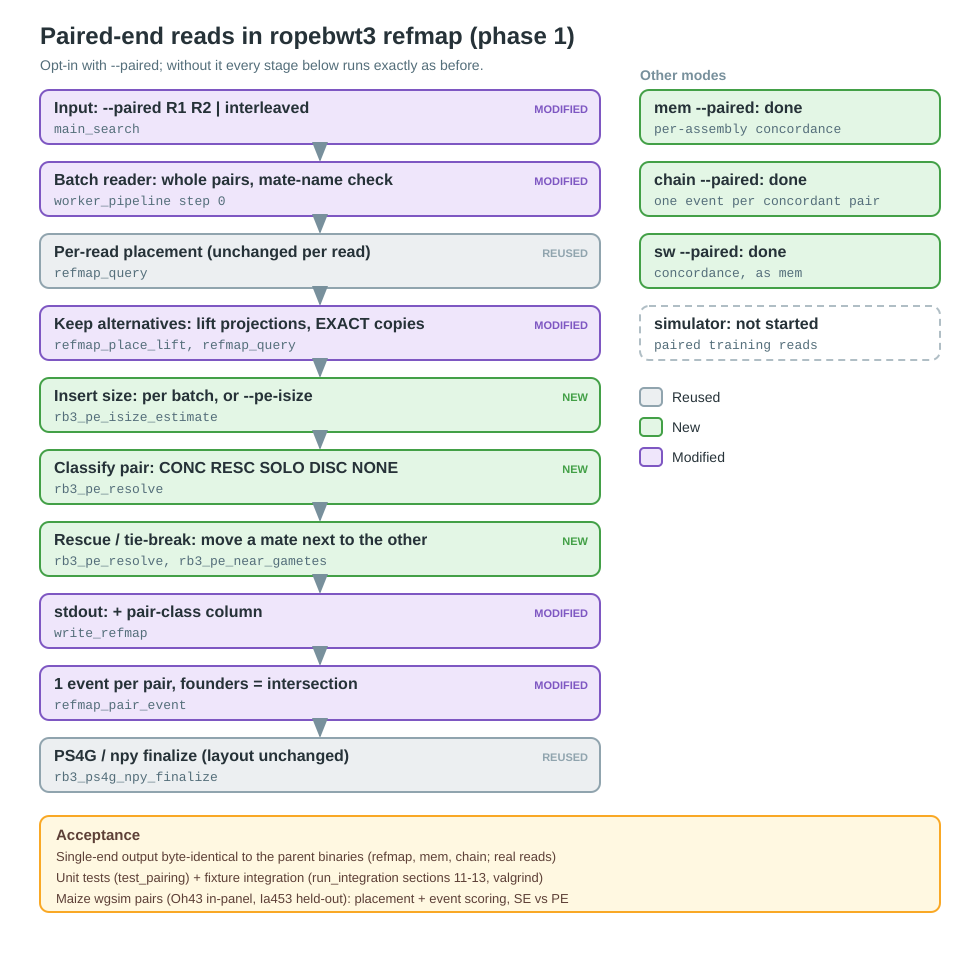

# Paired-end reads in ropebwt3 — plan and phase-1 status

*Regenerate the diagram (`python3 docs/paired-end/plan_diagram.py`) whenever the stage list changes.*

## Scope and decisions (2026-10-14)

| Question | Decision |
|---|---|
| Base | `local/paired-end` = `local/placed-fix` + merge of `chain-founder-support` (one binary for refmap + chain) |
| Input | `--paired` + two files (R1 R2) **or** one interleaved file; mate names must match up to `/1` `/2` |
| Insert size | bwa-style estimate per batch from EXACT/EXACT pairs (≥25), or fixed `--pe-isize=MEAN,SD` |
| Output | one PS4G/npy event per pair; founder set = intersection of the mates' sets |
| Phasing | phase 1 = I/O + insert size + refmap; phase 2 = chain; phase 3 = mem/sw |
| Simulator | stays single-end for now (separate step) |

Without `--paired` nothing changes: single-end output is byte-identical to the parent binaries.

## Phase 1: refmap (implemented)

**Pair classes** (`rb3_pe_resolve`; printed as a trailing stdout column, paired mode only):

| Class | When | PS4G/npy |
|---|---|---|
| `CONC` | both mates placed on one contig, `|Δpos| ≤ max_ins + --pe-slack` | 1 event at the anchor (EXACT beats PLACED; tie → mate 1) |
| `RESC` / `MOVED` | discordant, but one mate has an alternative position near the other: a PLACED mate's other lift projection, or an EXACT mate's other B73 copy. The less confident mate is moved first | the `MOVED` mate gets that position; 1 event at the anchor |
| `SOLO` | exactly one mate placed | 1 event at it |
| `DISC` | discordant and not rescuable | each mate is its own single-end event |
| `NONE` | neither mate placed | none |

**Founder set of a pair event** (`rb3_pe_event_gametes`): the sorted intersection of the two
mates' sets. If the intersection is empty, or the mate has no set, the anchor's set is used.
If one mate's occurrence sample was capped (`RB3_RM_MAX_ASSEMBLY`), it cannot veto founders and
the other mate's set is used. A `MOVED` mate first keeps only the founders whose own
projection landed near the anchor (`rb3_pe_near_gametes`). Without that, a TE/paralog copy
in another founder would count as sharing the fragment.

**`--pe-trust-exact` (opt-in):** a discordant EXACT + PLACED pair with no alternative near
the other mate moves the PLACED mate onto the EXACT one. It is off by default because on
non-collinear (insertion/TE) fragments the EXACT mate is often at a repeat copy (results below).

**Defaults:**
- `--pe-slack=2000`. That is the lift-projection error scale, the same as `--anchor-dist-thresh`.
- `max_ins = max(mean + 4·sd, p75 + 3·IQR)`.
- 1000 bp is used until a batch has 25 EXACT/EXACT pairs, with a one-time warning.

**Not supported with `--paired` (exits with an error):** chain/mem/sw (later phases),
`--walk-mode=per-assembly`, and `-L`.

**Code:**
- `pairing.c/h`: pure helpers.
- `search.c`:
  - `refmap_pair_batch` (step 1);
  - `refmap_pair_event` and `write_refmap` (step 2);
  - the pair-aligned reader in `worker_pipeline`.

## Validation (phase 1)

- **Unit:** `test/test_pairing.c` covers mate names, the insert-size estimator (hand-computed),
  every resolver class and tie-break, the near-projection founder filter, and every intersection
  fallback.
- **Integration:** `test/run_integration.sh` section 11 on the `docs/examples/pe/` fixture
  (`test/make_pe_fixture.py` documents its design). It checks:
  - the class of every hand-built pair;
  - P1's Mo17-only event set;
  - P5's rescue past a TE copy;
  - PS4G totals, per-read lines and npy↔PS4G agreement;
  - interleaved vs R1/R2 identity, pair-safe `-K` batches and `--pe-isize`;
  - all input-error paths;
  - a valgrind pass.
- **Real data, single-end identity:** `grits_workdir/scratch/paired_end/se_identity.sh` compares
  stdout, PS4G, npy and sidecars on 100k real reads, for refmap (production placed-fix flags),
  chain, and chain `--support=best --dup-count`, against the parent binaries.
- **Maize wgsim pairs:** `grits_workdir/scratch/paired_end/pe_sim_eval.sh`. It simulates 500k pairs
  each from Oh43 (in-panel) and Ia453 (held-out), runs refmap single-end and `--paired` on the
  same reads, and scores mate placement (`placement_truth.py`) and events
  (`pe_event_eval.py`). Results are below.

## Phase-1 results (2026-10-14, binary `1238c8b`)

**Single-end identity:** with `--paired` off, all 18 outputs are IDENTICAL to the parent binaries.
That is stdout, PS4G, npy and 3 sidecars for each of refmap, chain, and chain
`--support=best --dup-count`, on 100k real reads.

**Maize wgsim pairs:** 500k pairs per sample, 150 bp, inserts 500±50, `-e 0.001`. Production
refmap flags (k50 lift, `--lift-chain-nb=3 --lift-chain-interp`). SE is the same reads
single-end. Placement percentages are per mate row against the truth gVCF map; event
percentages are from `--ps4g-per-read`.

| | Oh43 SE | Oh43 PE | Oh43 PE+trust | Ia453 SE | Ia453 PE | Ia453 PE+trust |
|---|---|---|---|---|---|---|
| EXACT mates, wrong chr | 1.33 | 1.04 | 1.04 | 1.79 | 1.50 | 1.50 |
| PLACED collinear, <2 kb | 76.36 | 76.83 | 77.62 | 73.95 | 74.43 | 75.46 |
| PLACED collinear, wrong chr | 3.03 | 2.50 | 2.23 | 4.48 | 3.88 | 3.45 |
| PLACED non-collinear, wrong chr | 6.97 | 5.38 | 7.02 | 10.41 | 8.79 | 10.52 |
| events per fragment | 1.79 | 1.04 | 1.02 | 1.78 | 1.07 | 1.03 |
| wrong events (≥20 kb or wrong chr), count | 27,267 | 18,597 | 16,368 | 31,391 | 22,790 | 19,625 |
| fragments with any wrong event | 7.17 | 6.28 | 5.62 | 9.26 | 8.34 | 7.37 |
| mean founder-set size | 9.89 | 8.13 | 7.96 | 9.18 | 7.56 | 7.32 |
| true founder in the set | 98.85 | 97.38 | 97.46 | — | — | — |

Pair classes, Oh43 default: 317k CONC, 17k RESC, 98k SOLO (mostly MULTI + one placed mate),
17k DISC, 50k NONE. The estimated insert is mean 495 / sd 52.

**Reading the table:**
- Pairing cuts wrong events by about 32% and makes founder sets about 18% smaller.
- The intersection costs about 1.5 pp of true-founder recall on the in-panel line. In those
  cases one mate's sampled set is missing the true founder.
- 20–100 kb PLACED misplacement does not move. Those reads have no lift projection near
  their mate; the whole projection set is shifted.
- `--pe-trust-exact` is a trade-off. It helps collinear fragments but moves non-collinear
  ones onto EXACT mates at repeat copies.
- **Not yet measured:** the effect on GRITS model accuracy. The model was trained on
  single-end event statistics (see Next phases).

## mem (2026-10-16): per-assembly concordance, compared with minimap2

**Why mem next:** refmap's pair intersection lost about 1.5 pp of true-founder recall. In
`mem --paired`, founders are matched by location. A contig counts as carrying the fragment when
both mates hit it on opposite strands with implied read starts within the insert size
(`rb3_pe_concordant_hits`). CONC pairs print only those positions.

**The cause of the recall loss:** `-p` locates only a *sample* of a repetitive SMEM's
occurrences. A mate whose sample missed the true locus vetoed its partner's correct hit. On a
2k-pair smoke test that dropped at-locus recall from 91.1% to 88.5%. The fix is that a mate whose
longest SMEM was not fully located cannot filter its partner. Refmap's drop is probably the same
effect (sampled sets), which is untested.

**Comparison:**
- Reads: the same 500k wgsim pairs per sample as above.
- `mem`: `-p 128`, single-end vs `--paired`.
- minimap2 2.30: `-ax sr --secondary=yes -N 50` against all 25 assemblies (one-part index),
  single-end (R1 and R2 run separately) vs paired.
- Per-read founder set: the longest SMEM's printed positions (mem), or the alignments tied for
  the best `AS` (minimap2).
- Scorer: `scratch/paired_end/compare_eval.py`. Driver: `compare_mem_mm2.sh`.
- Percentages are of all reads.

| | mem SE | mem PE | minimap2 SE | minimap2 PE |
|---|---|---|---|---|
| Oh43: true founder at true locus (±1 kb) | 91.51 | **91.40** | 79.80 | 90.21 |
| Oh43: true founder anywhere in set | 99.00 | 96.59 | 84.12 | 91.99 |
| Oh43: mean founder set (assemblies) | 12.23 | 9.08 | 9.14 | 9.60 |
| Oh43: wrong B73 placement (collinear) | 7.16 | 3.78 | 3.49 | 1.81 |
| Oh43: no hit | 0.00 | 0.63 | 7.48 | 5.92 |
| Ia453: mean founder set | 11.82 | 8.78 | 8.48 | 8.88 |
| Ia453: wrong B73 placement | 7.37 | 4.01 | 3.47 | 1.96 |
| Ia453: no hit | 0.01 | 1.39 | 7.98 | 6.39 |
| Wall time / RAM (Oh43 paired, 16 threads) | 77 s / 9 GB | 77 s / 9 GB | 193 s / 109 GB | 122 s / 109 GB |

minimap2's index build took 9.3 min and 179 GB; the ropebwt3 index already existed.

**Reading the table:**
- mem pairing keeps locus recall (-0.11 pp) and cuts founder sets by 26%.
- "Anywhere in set" falls by design: those are Oh43 hits at TE or paralog copies elsewhere.
- Wrong B73 placements halve.
- minimap2 gains far more from pairing (+10.4 pp locus recall), because single-end it reports
  incomplete tie sets in a 25-copy pangenome. Paired, it is close to mem on recall and set size,
  with fewer wrong B73 placements but 6–8% of reads unmapped (repetitive minimizers are
  filtered).
- `b73_ok`/`b73_none` are not founder-correctness metrics: B73 hits are dropped exactly when B73
  does not carry the whole fragment.

### How much of the read a mem "hit" rests on; -p sampling; dropping discordant pairs (2026-10-16)

**What counts as a hit.** The founder set is the longest SMEM's hits, at least `-l 31` bp. The
longest SMEM covers the whole 150 bp read for 86.3% of Oh43 reads and 80.7% of Ia453 reads. For
Oh43 the rest is almost exactly the expected share of reads with a wgsim sequencing error (13.9%).

| Requiring the longest SMEM to cover ≥ (Oh43, mem PE, -p 128) | 31 bp | 75 bp | 120 bp | 150 bp |
|---|---|---|---|---|
| true founder at true locus | 91.40 | 91.22 | 84.48 | 79.70 |
| no hit | 0.63 | 0.83 | 8.4 | 13.7 |

**Where -p 128 misses come from.** 10.2% of reads have a longest SMEM with more than 128
occurrences, so only a sample is located. 72% of those miss the true locus: 7.3 pp of all reads.
Fully located reads miss only 1.35% of the time.

**-p 1024 and dropping DISC pairs**, Oh43, % of all reads (`scratch/paired_end/psweep/`,
`pe_filter_eval.py`):

| | at locus | mean set | wrong B73 | locus precision (kept) | kept | wall |
|---|---|---|---|---|---|---|
| mem SE -p 128 | 91.51 | 12.23 | 7.16 | — | 100 | 77 s |
| mem PE -p 128 | 91.40 | 9.08 | 3.78 | 91.98 | 99.4 | 77 s |
| mem PE -p 128, drop DISC | 89.22 | 8.20 | 2.00 | 94.90 | 94.0 | |
| mem SE -p 1024 | 96.26 | 12.25 | 4.49 | — | 100 | 169 s |
| **mem PE -p 1024** | **96.18** | **8.81** | **1.79** | 96.88 | 99.3 | 171 s |
| mem PE -p 1024, drop DISC | 95.47 | 8.61 | 1.47 | 97.68 | 97.7 | |
| minimap2 PE | 90.21 | 9.60 | 1.81 | 95.89 | 94.1 | 122 s + index |
| minimap2 PE, proper pairs only | 87.45 | 9.20 | 1.38 | 97.86 | 89.4 | |

**Takeaways:**
- At `-p 1024`, mem PE beats minimap2 PE on recall (+6 pp) with smaller founder sets.
- Dropping DISC pairs at `-p 1024` matches minimap2's proper-pair precision (97.7 vs 97.9) at
  +8 pp recall.
- With a fully located mate there are fewer discordant pairs: DISC falls from 29.5k to 8.9k.
- Remaining misses at `-p 1024`: 2.5 pp still capped, and 1.2 pp among fully located reads.
- There is no discard flag yet. DISC rows are printed with their pair class, so they can be
  filtered downstream.

### Tuned minimap2 + Ia453 at -p 1024 (2026-10-16): about parity

**Correction to the take above.** minimap2's defaults are wrong for a 25-genome pangenome. The
`sr` preset's `-f 1000,5000` ignores any seed with more than 1,000 occurrences, so low-copy
repeats go unmapped. Tuned: `-f 25000,50000 -N 100`, which drops primary unmapped from 6.1% to
0.5% on a 20k-pair pilot. The comparison also needs the same per-assembly pairing rule on both
sides: minimap2's tied-best hits are kept on a contig only if the mate has a tied-best hit within
1 kb on it (`pe_filter_eval.py sampair`).

| Oh43, % of reads | at locus | precision (kept) | set | wrong B73 | wrong B73 of kept | kept |
|---|---|---|---|---|---|---|
| mem PE -p 1024, all | 96.18 | 96.88 | 8.81 | 1.79 | 3.31 | 99.3 |
| mem PE -p 1024, drop DISC | 95.47 | 97.68 | 8.61 | 1.47 | 2.75 | 97.7 |
| mm2 tuned PE proper, raw tied sets | 96.25 | 97.29 | 11.06 | 2.89 | 4.54 | 98.9 |
| mm2 tuned PE proper, pair-filtered sets | 96.23 | 97.28 | 8.37 | 1.63 | 3.07 | 98.9 |

| Ia453 (held-out) | set | wrong B73 | wrong B73 of kept | kept |
|---|---|---|---|---|
| mem PE -p 1024, all | 8.46 | 2.17 | 4.27 | 98.4 |
| mem PE -p 1024, drop DISC | 7.87 | 1.53 | 3.08 | 93.1 |
| mm2 tuned PE proper, pair-filtered sets | 7.81 | 1.75 | 3.53 | 97.9 |

**Verdict: accuracy is about equal.**
- mem with DISC dropped is slightly more precise (wrong B73 about 0.2 pp lower).
- minimap2 keeps more reads: +1.2 pp in-panel, +4.8 pp held-out, where divergence produces
  more mem DISC pairs.
- mem's real advantages are cost and integration: 171–210 s and 9 GB on the existing ropebwt3
  index, against 366–388 s and 113 GB plus a 9-minute index build (179 GB peak) for minimap2.
  Pair-aware founder sets are also built in.

### refmap `--max-locate` (2026-10-16)

refmap's fixed 256-occurrence sample is now `--max-locate=INT` (default 256, so default output
is byte-identical). Rerunning the maize sims at `--max-locate=1024` with the production flags
(`--max-occ=-1`) gave **byte-identical output**. `--max-occ=-1` resolves to 25 (one per genome),
and every read with more occurrences is MULTI before anything is located, so the sample never
binds. The option matters only with `--max-occ=0` or a large `--max-occ`; refmap warns
otherwise. This rules out sampling as the cause of refmap's ~1.5 pp paired recall loss.

### Cause of refmap's paired recall loss (2026-10-16)

**Size.** Per fragment, the loss is smaller than the per-event 1.5 pp suggested. Single-end has
the true founder in at least one mate's event for 89.17% of Oh43 fragments; paired has it for
88.51%. That is 0.65 pp, and no fragment gains (`scratch/paired_end/refmap_loss_diag.py`).

**Cause.** 96% of lost fragments are RESC pairs whose two single-end sets *both* contained Oh43.
The rescued mate keeps only founders whose own lift projection lies within the concordance
window of the anchor (max insert + `--pe-slack`, about 2.7 kb). Lift projections are often
2–20 kb off, especially in non-collinear sequence, so the true founder was filtered out. In
collinear lost cases the event itself was at the truth 65% of the time (`resc_loss_pos.py`).

**Fix.** `--pe-near-win=NUM` gives that founder filter its own window. **Default: 100 kb**
(adopted 2026-10-16); 0 restores the old behaviour.
Oh43 results; positions and wrong events are unchanged in every row:

| `--pe-near-win` | PE recall (per fragment) | lost vs SE | mean set (Oh43 / Ia453) |
|---|---|---|---|
| default (~2.7 kb) | 88.51 | 0.65 pp | 8.13 / 7.56 |
| 20 kb | 88.88 | 0.29 pp | 8.15 / 7.58 |
| 100 kb | 88.98 | 0.19 pp | 8.16 / 7.59 |
| 1e9 (same-chromosome only) | 89.03 | 0.13 pp | 8.16 / 7.59 |

**What remains with 1e9:**
- 81%: the true founder's projection is on another chromosome. The filter always requires the
  same contig, which is what excludes TE copies elsewhere.
- 17%: the intersection legitimately lacks the founder because one mate's set did.

## chain --paired (2026-10-16, commit fb311bf)

**Decisions:**
- Mate gap ≤ max insert + `--max-intron` (+ `--pe-slack`, 0 for chain; +2 kb per lift-placed mate).
- One row and one event per CONC/SOLO pair, at the anchor's first segment.
- Founder set = intersection of the mates' sets; under `--support=best`, of their best sets.
- DISC mates are emitted single-end.
- Chain's three row paths go through `chain_put_row`; single-end output is byte-identical on
  real data (19/19).

**Maize wgsim, 500k pairs** (`scratch/paired_end/chain_fb311bf/`, `chain_pe_eval.sh`).
Flags: `--lift --lift-local-win=20000 --insertion-rows=ordinary`.

| | Oh43 def SE | Oh43 def PE | Oh43 best SE | Oh43 best PE | Ia453 def SE | Ia453 def PE | Ia453 best SE | Ia453 best PE |
|---|---|---|---|---|---|---|---|---|
| fragments with true founder in an event | 98.58 | 98.57 | 98.57 | 98.53 | — | — | — | — |
| mean founder set | 10.48 | 8.91 | 10.39 | 8.84 | 10.01 | 8.66 | 9.89 | 8.57 |
| wrong events (≥20 kb / chr) | 21,301 | 18,163 | 21,301 | 18,163 | 25,377 | 21,902 | 25,377 | 21,902 |
| fragments with any wrong event | 6.39 | 6.39 | 6.39 | 6.39 | 8.45 | 8.44 | 8.45 | 8.44 |
| wall time (16 threads) | 66 s | 63 s | 96 s | 79 s | 73 s | 71 s | 132 s | 104 s |

**Reading the table:**
- Recall is kept (≤0.04 pp).
- Founder sets are 14–15% smaller, and there are about 14% fewer wrong events.
- The fragment-level wrong rate is unchanged: chain has no rescue step, so a misplaced
  fragment stays misplaced. Refmap-style rescue is the next lever if that matters.
- 22% of pairs are NONE: neither mate chains, as in single-end mode.

## sw --paired (2026-10-16, commit 4f7c07a)

**Design.** The same per-assembly concordance as mem (`rb3_pe_concordant_hits`), over every
located position of every PAF hit:
- CONC lines keep only concordant positions; a hit with none is dropped.
- Every line gets a `pe:Z:` tag.
- A mate whose best hit was only partly located cannot veto.
- Needs `-p`: `sw`'s `-p` is a per-read budget, and 0 locates one position per hit.

**Checks.** Single-end output is byte-identical on real data (20/20, including a new `sw -p 64`
arm). The identity script now `cmp`s npy files directly: `grep` treats them as binary and passes
their content through only partly, so earlier npy checks were re-verified, all 8 runs identical.

**Maize wgsim, 500k pairs, `-p 1024`** (`scratch/paired_end/sw_4f7c07a/`, `sw_pe_eval.sh`),
% of reads:

| | Oh43 at locus | Oh43 set | Oh43 wrong B73 | Oh43 prec (kept) | Oh43 kept | Ia453 set | Ia453 wrong B73 | Ia453 kept |
|---|---|---|---|---|---|---|---|---|
| sw SE | 96.69 | 12.04 | 4.19 | — | 100 | 11.49 | 4.60 | 100 |
| sw PE | 96.64 | 8.66 | 1.77 | 96.64 | 100 | 8.30 | 2.19 | 100 |
| sw PE, drop DISC | 95.47 | 8.37 | 1.33 | 97.95 | 97.5 | 7.47 | 1.32 | 91.6 |
| mem PE -p 1024 | 96.18 | 8.81 | 1.79 | 96.88 | 99.3 | 8.46 | 2.17 | 98.4 |
| mem PE, drop DISC | 95.47 | 8.61 | 1.47 | 97.68 | 97.7 | 7.87 | 1.53 | 93.1 |
| mm2 tuned PE proper, pair-filtered | 96.23 | 8.37 | 1.63 | 97.28 | 98.9 | 7.81 | 1.75 | 97.9 |

**Reading the table:**
- sw PE keeps recall (−0.05 pp).
- On in-panel reads sw PE has the best recall of the three tools, and with DISC dropped the
  lowest wrong-B73 rate and the highest precision.
- sw has the most DISC pairs on the held-out line (42k vs mem 26k), so dropping them costs the
  most reads there (91.6% kept).
- Cost: sw ~240 s, 17–20 GB; mem 171–210 s, 9 GB; minimap2 366–388 s, 113 GB plus index.

## Next phases

- **Phase 2, chain:** done (see above). Originally planned:
  - Link SMEM chains across mates: a mate's chain that is colinear with the other's within the
    insert counts as one fragment.
  - One event per pair, with the founder set = intersection.
  - `--dup-count` must dedup on the pair; the `;x=N` suffix would sit on the fragment name.
- **Phase 3, mem/sw:** bwa-style pair scoring and mate rescue (SW of the unaligned mate inside
  the insert window).
- **Downstream:**
  - The GRITS simulator and training corpus are single-end. Paired PS4G events have different
    statistics (fewer events, tighter founder sets), so a model trained on single-end features
    needs a recalibration or retrain check before paired data is used for real.
  - Retune the router `disj` whenever placement changes (memory `placed_fix_chain_projection`).
